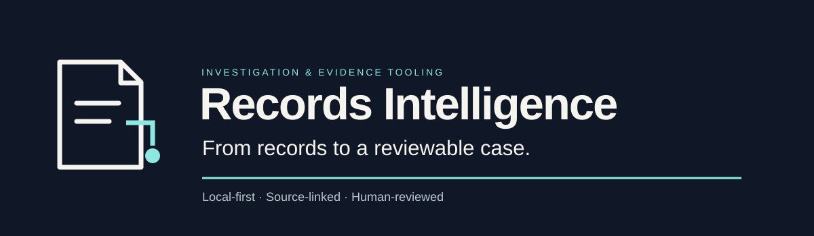

# Records Intelligence

I build **Records Intelligence**, a local-first tool that turns a small set of supplied PDFs into a **draft review pack**: every finding is linked to the passage and page it rests on, the original files and each revision are kept, unresolved gaps are listed, and the human review decision stays visible.

**[Project overview](https://claudedclaude2-byte.github.io/)** · **[What exists today](https://claudedclaude2-byte.github.io/platform.html)** · **[Public roadmap](https://github.com/claudedclaude2-byte/claudedclaude2-byte.github.io/blob/main/ROADMAP.md)** · **[Scope and limits](https://claudedclaude2-byte.github.io/trust.html)** · **[Contact](mailto:kimivacko@yahoo.com)**

## A small evaluation, on fictional documents first

| | Current pilot scope |
| --- | --- |
| **You supply** | One factual question, the statements to check and up to 6 born-digital PDFs (20 pages in total, at most 10 per document) |
| **You get** | A draft review pack: exact and possible passage matches, missing records, differing values, a chronology of recognised dates, and links back to the source pages |
| **Corrections** | One correction round. It produces revision 2 with a reason; revision 1 stays available for comparison |
| **Review** | A reviewer records a decision and its basis. Changing the content makes that approval stale |
| **Scans** | Optional, and only with individually reviewed transcripts |

The first conversation needs no client documents: ask to see the **fictional sample**, or describe **one preparation or checking step** you would like to make easier.

## Where it stands · October 2026

- **Built:** local components for records requests, evidence search, source provenance, reviewed redaction, and versioned dossiers with an independent offline verifier.
- **Pilot:** the bounded PDF route above, in private validation on the builder's own Windows machine.
- **Sample:** a fictional walkthrough kit is frozen, and its backup copy has been checked against the same checksums.
- **Still open:** integration of the latest packaging and startup fixes, installation on a clean machine, and a public runnable release. There is no hosted app, upload portal or public download, and no production use is offered.

A passing check confirms only what that check covers. It does not establish that a source is true, authentic or complete, and nothing here is legal advice.

**Stack:** Python · SQLite/FTS5 · local Flask/Jinja interfaces · Windows-first, offline. The implementation repository is private.

## Where the project is going

The ambition is a complete investigation workbench: records requests, documents, source-linked findings, corrections and follow-up questions in one inspectable trail.

| Stage | Direction |
| --- | --- |
| **Built** | Records workflows, evidence search, provenance, reviewed redaction and versioned dossiers |
| **Now** | Integrate the latest pilot packaging, startup and documentation fixes; refresh the fictional demo |
| **Next** | Clean-machine installation, clearer first use and guided fictional partner evaluations |
| **Planned** | Richer revision comparison, request-gap integration and source-change context |
| **Longer term** | Partner integrations, shared review, an optional hosted workspace and deeper discovery |

Later stages are intended or exploratory work, with no announced release dates. See the [full public roadmap](https://github.com/claudedclaude2-byte/claudedclaude2-byte.github.io/blob/main/ROADMAP.md) for the stages and milestones.

## Contact

**Miroslav Kovac** · [kimivacko@yahoo.com](mailto:kimivacko@yahoo.com)

Please do not send client documents or personal data in a first message.

